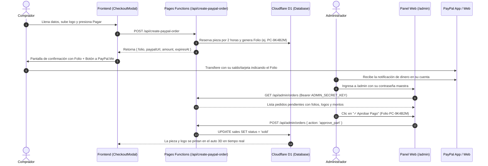

# Guía de Integración: Pagos con PayPal Estándar (PayPal.Me) y Panel D1

Esta documentación describe la arquitectura, configuración y funcionamiento del sistema de cobros con **cuenta estándar de PayPal (PayPal Personal)** para **Proyect Car**, desplegado sobre el ecosistema serverless de **Cloudflare Pages** y base de datos **Cloudflare D1**.

---

## 1. Visión General de la Arquitectura

A diferencia de pasarelas con webhooks automáticos como Stripe, una cuenta estándar o personal de PayPal no cuenta con credenciales de API de comercio ni webhooks en tiempo real. 

Para resolver esto manteniendo **seguridad total, prevención de dobles ventas y experiencia de compra premium**, se implementó una arquitectura basada en:

1. **Pre-registro y Reserva Atómica (Cloudflare D1)**:
   - Al hacer clic en pagar, el backend aparta la pieza o registra el mensaje durante **2 horas** (`status: 'reserved'`).
   - Genera un **Folio único** alfanumérico legible (ej: `PC-9K4B2M`).
   - Evita que dos personas aparten la misma pieza al mismo tiempo.
2. **Cobro Directo Vía PayPal.Me Dinámico**:
   - Se genera el enlace oficial con el monto exacto: `https://paypal.me/<PAYPAL_ME_USER>/<MONTO><DIVISA>`.
   - Se instruye al comprador a incluir su Folio en la nota de pago de PayPal.
3. **Panel de Control Seguro (`/admin`)**:
   - Interfaz web protegida por contraseña (`ADMIN_SECRET_KEY`).
   - Permite al administrador revisar las órdenes pendientes, confirmar la recepción del dinero en su app de PayPal y **aprobar la venta en 1 clic**.
4. **Actualización Inmediata en el Auto 3D**:
   - En cuanto el administrador presiona *Aprobar Pago*, la pieza pasa a `sold` y el visualizador 3D se actualiza en tiempo real para todos los visitantes del sitio.

---

## 2. Documentación de Funciones Específicas

### 2.1 `create-paypal-order.ts` (`POST /api/create-paypal-order`)
- **Propósito**: Validar disponibilidad de inventario, registrar el apartado temporal de 2 horas en D1 y generar el Folio de compra con la URL dinámica de PayPal.Me.
- **Parámetros de Entrada**:
  - `partId` *(string)*: Identificador de la pieza o salpicadera.
  - `brand` *(string, opcional)*: Nombre de la marca patrocinadora.
  - `color` *(string, opcional)*: Código HEX del color elegido.
  - `email` *(string)*: Correo electrónico del comprador.
  - `logoUrl` *(string, opcional)*: URL del logo previamente cargado en `/api/upload-logo`.
  - `link` *(string, opcional)*: Enlace web de la marca patrocinadora.
  - `msg` *(string, opcional)*: Mensaje para la salpicadera (máx. 24 caracteres).
  - `roofName` *(string, opcional)*: Nombre de cortesía para el techo de la raza.
  - `cur` *('MXN' | 'USD')*: Divisa seleccionada.
- **Validaciones de Servidor**:
  - Verifica que el `partId` pertenezca al catálogo oficial y que no sea una pieza no comercializable (techo).
  - Consulta en Cloudflare D1 que la pieza no esté `sold` ni `reserved` activamente (`reserved_until > now`).
  - Para mensajes, valida que la salpicadera no supere el cupo máximo de 120 mensajes.
- **Salida**:
  - `{ ok: true, folio: "PC-XXXXXX", partId, partName, amount, currency, paypalUser, paypalUrl, expiresAt }`.

---

### 2.2 `admin/orders.ts` (`GET & POST /api/admin/orders`)
- **Propósito**: Endpoint administrativo protegido para consultar el listado consolidado de pedidos y realizar cambios de estado atómicos en D1.
- **Seguridad**:
  - Requiere el encabezado HTTP: `Authorization: Bearer <ADMIN_SECRET_KEY>`.
- **`GET /api/admin/orders`**:
  - Retorna métricas globales: Total recaudado en MXN, piezas vendidas, órdenes pendientes y mensajes registrados.
  - Retorna la lista de piezas con sus estados, folios, comprador, logos y tiempo restante de reserva.
- **`POST /api/admin/orders`**:
  - Recibe el cuerpo JSON:
    - `{ action: 'approve_part', partId }`: Cambia `status = 'sold'` y elimina `reserved_until`.
    - `{ action: 'reject_part', partId }`: Cambia `status = 'available'` y libera la pieza inmediatamente.
    - `{ action: 'approve_message', messageId }`: Cambia `status = 'approved'` para que sea visible en el muro público.
    - `{ action: 'reject_message', messageId }`: Cambia `status = 'rejected'`.

---

### 2.3 `sales.ts` (`GET /api/sales`)
- **Propósito**: Endpoint público consumido por el frontend y el visualizador Three.js cada 30 segundos.
- **Comportamiento**:
  - Retorna las piezas vendidas (`status = 'sold'`) con marca, color y logo.
  - Retorna las piezas actualmente apartadas (`status = 'reserved'` con tiempo vigente) para bloquear el botón de compra a otros usuarios.
  - Retorna únicamente los mensajes de la raza cuyo estado sea `approved`.

---

## 3. Variables de Entorno Requeridas

Configúralas en el panel de **Cloudflare Pages** (*Settings* > *Environment Variables*):

| Variable | Tipo | Descripción | Ejemplo |
|---|---|---|---|
| `VITE_PAYPAL_ME_USER` | Pública / Build | Tu nombre de usuario o enlace corto de PayPal.Me | `TuCuenta` (resulta en `paypal.me/TuCuenta/...`) |
| `ADMIN_SECRET_KEY` | Secreta (Encrypted) | Contraseña maestra para iniciar sesión en `/admin` | `TuContraseñaUltraSegura2026` |
| `DB` | D1 Database Binding | Vinculación nativa a la base de datos Cloudflare D1 | Binding `DB` apuntando a `proyect_car_db` |

---

## 4. Manual de Operación para el Administrador

1. **Revisión Diaria / Alertas**:
   - Cuando alguien aparta una pieza, PayPal te notificará a tu app o correo sobre la recepción de dinero.
2. **Acceso al Panel**:
   - Ingresa a `https://tudominio.com/admin`.
   - Escribe tu `ADMIN_SECRET_KEY`. La sesión se mantiene activa en tu navegador.
3. **Verificación del Folio**:
   - Localiza la orden en la pestaña **Órdenes Pendientes**.
   - Coteja que el **Folio** (`PC-XXXXXX`) y el **Monto** coincidan con la nota de la transferencia recibida en PayPal.
4. **Aprobación**:
   - Haz clic en el botón verde **✓ Aprobar**.
   - La orden pasa a la pestaña *Vendidas* y el auto 3D se actualiza automáticamente.
5. **Liberación por No Pago**:
   - Si transcurren las 2 horas sin recibir el pago (o el usuario notifica que canceló), puedes hacer clic en **✕ Liberar** para habilitar la pieza de inmediato para otro comprador.
